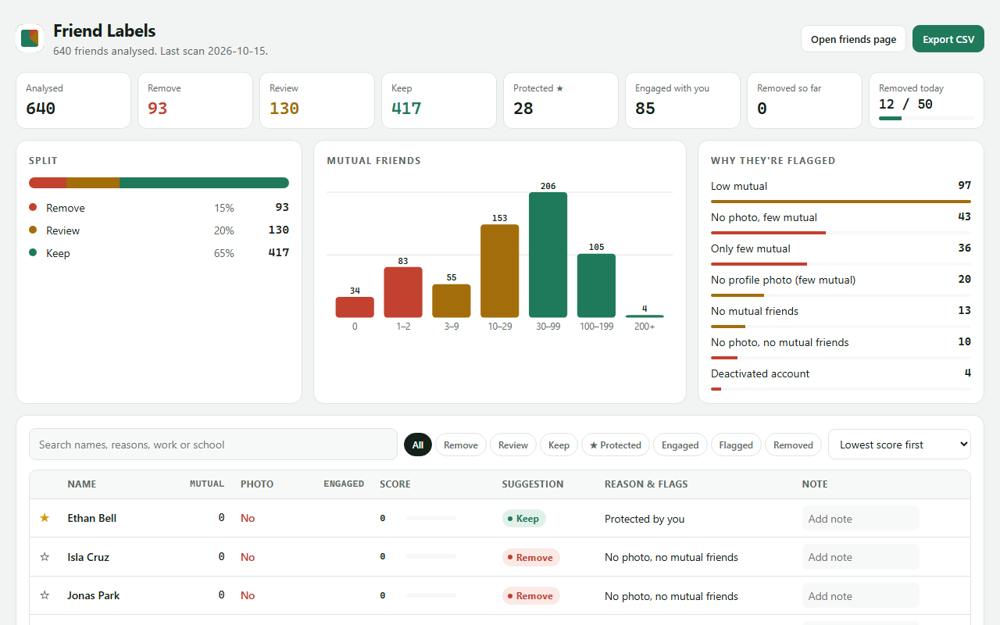

# Friend Labels

A free, open-source Chrome extension that helps you tidy your Facebook friends list.
It labels every friend **Keep**, **Review** or **Remove**, explains why, and gives you a dashboard to sort, filter, protect and export.

> **Display only.** Friend Labels never clicks Unfriend, never likes, never sends requests or messages. You make every decision yourself.

_Screenshots use fictional sample data._

## Features
- Label on every card of your Friends page: Keep / Review / Remove, with a reason and a 0–100 score
- Engagement tracking: friends who react or comment on *your* posts get a higher score
- ★ Protect friends so they are always kept
- Full dashboard: charts, search, filters, notes, CSV export
- Adjustable rules (mutual-friend thresholds, daily removal counter)
- 100% local: no servers, no analytics, no accounts

## Install (developer mode)
1. Download or clone this repo: `git clone https://github.com/riyajkm/friend-labels-ext.git`
2. Open `chrome://extensions` and enable **Developer mode**.
3. Click **Load unpacked** and select this folder.
4. Open your Facebook Friends page; labels appear on the cards. Click the toolbar icon for the popup, or open the dashboard from the extension options.

## How scoring works
Score = mutual friends (log scale, up to 55) + profile photo (15) + engagement on your posts (up to 30).
Rules in the dashboard decide the Keep / Review / Remove thresholds. See `lib.js`.

## Privacy
Everything stays in your browser's local extension storage. Nothing is transmitted. See [PRIVACY.md](PRIVACY.md).

## Disclaimer
Not affiliated with or endorsed by Meta or Facebook. Facebook's page markup changes often, so selectors may break; please open an issue. Use at your own risk and follow Facebook's Terms.

## Contributing
Issues and PRs welcome, see [CONTRIBUTING.md](CONTRIBUTING.md).

## License
[MIT](LICENSE)
